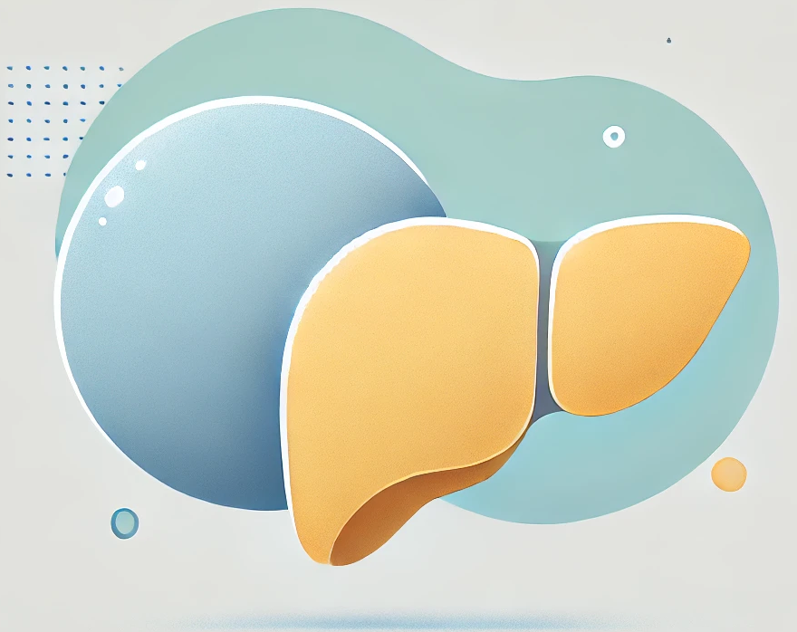

##### Welcome to the website of the ADIPOcyte and FAT biology Lab.

* We study adipocyte biology and its role in health and disease. Collaborating with basic and clinical researchers, we focus on the pathophysiological effects of obesity, particularly the metabolic dysfunction-associated steatotic liver disease (MASLD) and its progression to liver cancer. 
* Our work aims to identify biomarkers and develop approaches for personalized medicine, addressing the challenges faced by obese patients and the professionals who care for them. 
* We apply advanced omics technologies, including spatial omics, and AI tools, including large language models (LLMs), to improve our understanding and find practical solutions.

```{=html}
<div class="landing-video">
  <video id="landing-video" autoplay muted loop playsinline preload="auto"
         poster="img/adipofat-landing-poster.jpg" aria-label="AdipoFat lab video">
    <source src="img/adipofat-landing.mp4" type="video/mp4">
  </video>
  <button type="button" id="landing-sound" class="landing-sound"
          aria-label="Unmute video" aria-pressed="false">
    <i class="bi bi-volume-mute-fill"></i>
  </button>
  
</div>

<script>
// Muted autoplay is the only kind browsers allow; the button turns sound on and off.
// Visitors who ask for reduced motion get the still picture instead (see the CSS),
// so the video is removed for them before it plays.
(function () {
  const video = document.getElementById("landing-video");
  const button = document.getElementById("landing-sound");
  const icon = button.querySelector("i");

  if (window.matchMedia("(prefers-reduced-motion: reduce)").matches) {
    video.pause();
    video.remove();
    button.remove();
    return;
  }

  function sync() {
    const on = !video.muted;
    icon.className = on ? "bi bi-volume-up-fill" : "bi bi-volume-mute-fill";
    button.setAttribute("aria-label", on ? "Mute video" : "Unmute video");
    button.setAttribute("aria-pressed", String(on));
  }

  button.addEventListener("click", function () {
    video.muted = !video.muted;
    if (video.paused) video.play();
    sync();
  });
})();
</script>
```